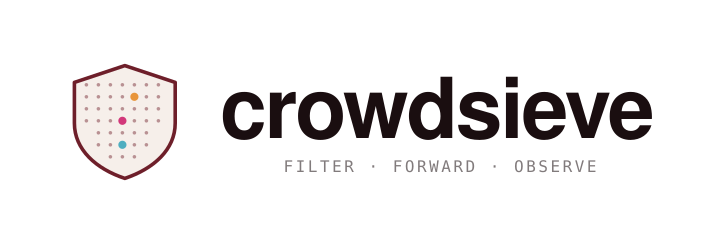
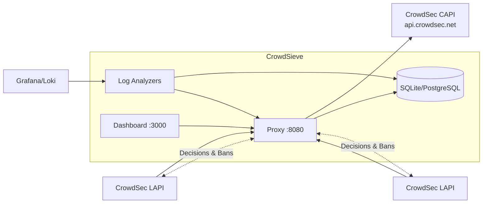

<a href="https://www.linagora.com"></a>


<br clear="all">

A filtering proxy for CrowdSec that sits between your local CrowdSec instances (LAPI) and the Central API (CAPI). Filter alerts before they're sent to the CrowdSec console, and visualize them in a local dashboard.

## Features

- **Alert Filtering**: Powerful expression-based filter rules with logical operators (and, or, not)
  - Field operators: eq, ne, gt, lt, in, contains, starts_with, ends_with, regex, glob, cidr
  - Combinable conditions for complex filtering logic
- **Log Analyzers**: Scheduled log analysis from Grafana/Loki with automatic ban pushing
  - Configurable detection rules (YAML) with grouping, distinct counting, and thresholds
  - Global whitelist for IPs and CIDR ranges
  - Push decisions to all your CrowdSec LAPI servers
- **Bouncer Metrics**: Transparent capture of CrowdSec `usage-metrics` as LAPI relays them to CAPI (CrowdSec ≥ 1.6) — visualize per-bouncer blocked requests in the dashboard with no extra LAPI configuration
- **Client Validation**: Optional validation of CrowdSec clients against CAPI before accepting alerts
- **Dashboard**: Web interface to visualize alerts with GeoIP enrichment
- **Dashboard Authentication**: Two modes, both documented in [docs/oidc-authentication.md](./docs/oidc-authentication.md)
  - **OIDC** with any OpenID Connect provider (Keycloak, LemonLDAP::NG, Auth0, Okta, etc.), including Private Key JWT (`private_key_jwt`), encrypted tokens (JWE), and back-channel logout.
  - **HTTP Headers** for deployments behind a trusted reverse proxy (LemonLDAP-NG handler, NGINX `auth_request`, Apache `mod_auth_*`, etc.) — identity is forwarded via `Auth-*` headers.
- **Status Page**: Health of CAPI forwarding and of every LAPI server (periodic check), with a red banner on every page when something fails
- **Decision Search**: Query active decisions for any IP across all your LAPI servers
- **Manual Bans**: Ban IPs directly from the dashboard, pushing decisions to your local CrowdSec LAPI servers
  - `ban` or `captcha` remediation, preset or custom duration (1 minute to 365 days), up to 100 IPs/ranges per submission
- **Audit Log**: Who banned or unbanned what, when, on which server, for how long and why, filterable by user and exportable as CSV
- **REST API**: Fully documented with OpenAPI ([interactive docs](https://linagora.github.io/crowdsieve/api/) · [openapi.json](https://linagora.github.io/crowdsieve/api/openapi.json))
- **Transparent Proxy**: Forwards non-filtered alerts to CAPI
- **GeoIP Enrichment**: Enrich alerts with geographic information
- **Lightweight**: Docker image under 200MB

## Why Crowdsieve?

### A Paradigm Shift in Alert Management

Traditional CrowdSec architecture embeds intelligence in each scenario to determine which alerts are "significant enough" to be sent to the Central API (CAPI). This means:

- Local filtering happens at the scenario level
- Only high-confidence alerts reach the central console
- Internal IPs or minor events are typically discarded before you can see them

**Crowdsieve changes this approach:**

| Traditional CrowdSec     | With Crowdsieve              |
| ------------------------ | ---------------------------- |
| Filtering in scenarios   | Filtering in proxy           |
| Limited local visibility | Full local visibility        |
| All alerts go to CAPI    | Selective CAPI forwarding    |
| Internal IPs discarded   | Internal IPs visible locally |

### Key Benefits

1. **Complete Local Visibility**: See ALL alerts in your dashboard, including minor events and internal IPs, without polluting the central CrowdSec console

2. **Decoupled Filtering**: Generate less aggressive alerts at the scenario level, then filter what goes to CAPI at the proxy level - giving you full control

3. **Internal Network Monitoring**: Monitor internal IP activity (10.x, 172.16.x, 192.168.x) locally without sending them to the central console

4. **Flexible Export Control**: Keep sensitive or noisy data local while still contributing meaningful threat intelligence to the community

### Roadmap

- **Extended Analyzer Sources**: Support for additional log sources beyond Grafana/Loki (Elasticsearch, direct file reading, etc.)

## Quick Start

### Using Docker

```bash
# Pull and run the image (dashboard published on localhost only)
docker run -d -p 8080:8080 -p 127.0.0.1:3000:3000 yadd/crowdsieve:latest

# Or use docker compose
git clone https://github.com/linagora/crowdsieve.git
cd crowdsieve
docker compose up -d
```

The container runs both services:

- **Proxy**: http://localhost:8080 (for CrowdSec LAPI)
- **Dashboard**: http://localhost:3000 (web interface)

> **Security:** without authentication settings the dashboard is open to anyone who can reach it, including ban and unban. The examples above, and `docker-compose.yml` (`DASHBOARD_BIND`, default `127.0.0.1`), therefore publish it on the loopback interface only. Configure [dashboard authentication](#dashboard-authentication) before exposing it; the dashboard logs a warning at startup while none is configured.

### Using Helm (Kubernetes)

```bash
# Add the Helm repository
helm repo add crowdsieve https://linagora.github.io/crowdsieve
helm repo update

# Install CrowdSieve with CrowdSec
helm install crowdsieve crowdsieve/crowdsieve -n security --create-namespace

# Or with custom values
helm install crowdsieve crowdsieve/crowdsieve -f values.yaml -n security --create-namespace
```

The Helm chart includes CrowdSec as a dependency. See the [Helm chart documentation](./helm/crowdsieve/README.md) for configuration options including PostgreSQL backend, GeoIP enrichment, and filter rules.

### Manual Installation

```bash
# Install dependencies
npm install
cd dashboard && npm install && cd ..

# Start in development mode (2 terminals)
npm run dev              # Terminal 1: Proxy on :8080
npm run dev:dashboard    # Terminal 2: Dashboard on :3000

# Build for production
npm run build
npm start
```

## Configuration

### CrowdSec Client Configuration

On each CrowdSec server that should use the proxy, update `/etc/crowdsec/online_api_credentials.yaml`:

```yaml
# Before
url: https://api.crowdsec.net/

# After
url: http://YOUR_PROXY_IP:8080/
```

Then restart CrowdSec:

```bash
sudo systemctl restart crowdsec
```

### Proxy Configuration

Edit `config/filters.yaml`:

```yaml
proxy:
  listen_port: 8080
  capi_url: 'https://api.crowdsec.net'
  timeout_ms: 30000
  forward_enabled: true # Set to false for test mode

storage:
  path: './data/crowdsieve.db'
  retention_days: 30

filters:
  mode: 'block' # "block" = matching alerts NOT forwarded; "allow" = only matching forwarded
  # Rules are loaded from config/filters.d/*.yaml
```

### LAPI Servers (Decisions & Manual Bans)

To view decisions and enable manual IP banning from the dashboard, configure your local CrowdSec LAPI servers:

```yaml
lapi_servers:
  - name: 'server1'
    url: 'http://localhost:8081'
    api_key: 'your-bouncer-api-key' # For reading decisions
    machine_id: 'crowdsieve' # For manual banning (optional)
    password: 'your-machine-password' # For manual banning (optional)
  - name: 'server2'
    url: 'http://192.168.1.10:8080'
    api_key: 'another-bouncer-key'
```

**Bouncer API key** (required): For querying decisions. Generate with:

```bash
cscli bouncers add crowdsieve-dashboard
```

See [CrowdSec bouncers documentation](https://docs.crowdsec.net/docs/cscli/cscli_bouncers_add/).

**Machine credentials** (optional): For manual banning from the dashboard. Register a machine with:

```bash
# Interactive (will prompt for password)
cscli machines add crowdsieve

# Or with auto-generated password (note it down for config)
cscli machines add crowdsieve --auto
```

See [CrowdSec machines documentation](https://docs.crowdsec.net/docs/cscli/cscli_machines_add/).

When multiple servers are configured, you can ban an IP on all servers at once or select a specific server. Manual bans use the `crowdsieve/manual` scenario with immediate effect.

The **Manual Ban** card (home page and alert details) offers:

- **Remediation**: `Ban` (default) or `Captcha`. It is the decision `type` sent to the LAPI; your bouncers must support it.
- **Duration**: 1 hour, 4 hours (default), 24 hours, 7 days, 30 days, or **Custom…** (a number of minutes, hours or days, from 1 minute to 365 days; the proxy enforces the same bounds).
- **Several IPs**: paste IP addresses or CIDR ranges, one per line or separated by commas or spaces (at most 100 per submission). Invalid values are listed and block the submission, duplicates are removed. One ban request is sent per value (5 at a time), each with its own audit row and the same reason; the values that failed stay in the field for a retry.

The REST endpoint is `POST /api/decisions/ban` with `{ server, ip, duration, reason, type? }`, where `type` is `ban` (default) or `captcha` and `duration` must be between `1m` and `8760h`.

The operator who issued a manual ban is recorded on a local audit row at once. When the ban's alert later comes back from the LAPI through `/v2/signals` or `/v3/signals`, its `actor` event meta is only kept if this instance recorded a manual ban by that same operator on that same target within the last 24 hours. Any other `actor` meta received through signals is ignored (and logged), so a forged signal cannot appear as a ban by a named operator.

### Decision Replication

CrowdSieve can optionally replicate received decisions to your LAPI servers. This is useful when you have multiple CrowdSec instances and want to share decisions across them without going through CAPI.

Enable replication for a server by adding `replicate_decisions: true` and `source_machine_ids`:

```yaml
lapi_servers:
  - name: 'lapi1'
    url: 'http://localhost:8081'
    api_key: 'your-bouncer-api-key'
    machine_id: 'crowdsieve'
    password: 'your-machine-password'
    replicate_decisions: true
    # Online API login of this LAPI (online_api_credentials.yaml), then its agents
    source_machine_ids: ['4b1d0c2e...lapi1-online-api-login', 'agent1', 'agent2']
  - name: 'lapi2'
    url: 'http://192.168.1.10:8080'
    api_key: 'another-bouncer-key'
    machine_id: 'crowdsieve-2'
    password: 'another-password'
    replicate_decisions: true
    source_machine_ids: ['9f3e7a51...lapi2-online-api-login', 'agent3']
```

**Who may have its decisions replicated:**

Replication writes into the decision base of every target LAPI, so CrowdSieve only replicates decisions sent by a LAPI it knows:

1. The sender must be **authenticated against CAPI**: CAPI must have accepted its `Authorization` header with a 2xx (now, or within `CLIENT_VALIDATION_CACHE_TTL`). This check runs even when `client_validation` is disabled, as soon as replication is configured; it then only decides about replication, not about accepting the request. A fail-open result (CAPI unavailable) does not count.
2. The machine id of the sender's JWT (the `id` claim, i.e. the `login` of the LAPI's `/etc/crowdsec/online_api_credentials.yaml`) must be listed in the `source_machine_ids` of one of the `lapi_servers`. The allowlist is the **union** of all `source_machine_ids`, including servers without `replicate_decisions` (a LAPI may be a source only). The `machine_id` fields of the alerts themselves are never used to authorize a sender.

Signals that fail either check are still stored and forwarded to CAPI as usual, but their decisions are not replicated, and a warning is logged (once per 15 minutes per sender).

> **Upgrade note:** `source_machine_ids` used to be matched against the `machine_id` of the alerts only (the agents). Add the online API `login` of each LAPI to its `source_machine_ids`, or nothing will be replicated. To find it: `grep login /etc/crowdsec/online_api_credentials.yaml` on the LAPI host, or look for the warning `sender machine id is not listed in any lapi_servers[].source_machine_ids`, which carries the `machineId` CrowdSieve saw.

**Which decisions are replicated:**

Even from a trusted sender, only bounded IP remediations are replicated, with these limits:

- scope `Ip` or `Range` only (any case); `Country`, `AS`, `Username` and other scopes are dropped;
- type `ban` or `captcha` only; other remediations (`throttle`, custom types) are dropped;
- ranges broader than an IPv4 `/16` or an IPv6 `/32` are dropped, as are IPv6 ranges covering the IPv4-mapped block `::ffff:0:0/96` or more than a `/16` of it;
- the duration must be a positive Go duration (`4h`, `1h30m`...); longer than `replication.max_decision_duration` (default `168h`, 7 days), it is replicated with that maximum;
- only `type`, `scope`, `value`, `duration`, `scenario` and `simulated` are copied, with `origin: crowdsieve-replication`.

Dropped and capped decisions are logged at `warn` level. The cap is configured in `config/filters.yaml` (Go duration syntax, no `d` unit):

```yaml
replication:
  max_decision_duration: '168h'
```

**How it works:**

- When CrowdSieve receives alerts with decisions (via `/v2/signals` or `/v3/signals`) from a trusted sender (see above), it replicates those decisions to LAPI servers with `replicate_decisions: true`
- Decisions are **not** replicated back to the server they originated from (based on `source_machine_ids`)
- Replication is asynchronous and non-blocking (doesn't slow down the main request)
- Errors during replication are logged but don't affect the response to the client
- **All** decisions are replicated, including those from filtered alerts

**Loop prevention:**

CrowdSieve includes multiple mechanisms to prevent infinite replication loops:

1. **Source server exclusion**: Decisions are not replicated back to the server they originated from: the server whose `source_machine_ids` holds the sender's online API machine id, and any server whose `source_machine_ids` holds the `machine_id` of one of the alerts (agent ids, which can only remove targets). The same `source_machine_ids` are also used to resolve the friendly server name when capturing `usage-metrics` from the LAPI's CAPI relay — if the LAPI's online API machine_id matches one of these entries, the row is tagged with this server's `name` instead of the raw machine_id.
2. **Origin tagging**: Replicated decisions are marked with `origin: crowdsieve-replication`
3. **Origin filtering**: Decisions with `crowdsieve` or `crowdsieve-replication` origins are never replicated
4. **CAPI filtering**: Crowdsieve-originated alerts are not forwarded to CAPI

**Requirements:**

- Machine credentials (`machine_id` and `password`) must be configured for replication to work
- The machine must be registered on the target LAPI server (`cscli machines add crowdsieve`)
- **Important**: Configure `source_machine_ids` with the online API machine id of each LAPI that sends decisions (required for replication at all), plus its agent machine IDs if you want them to exclude targets too

### Environment Variables in Config

Sensitive values like passwords and API keys can be loaded from environment variables using the `${VAR_NAME}` syntax:

```yaml
lapi_servers:
  - name: 'server1'
    url: 'http://localhost:8081'
    api_key: '${LAPI_API_KEY}'
    machine_id: '${LAPI_MACHINE_ID:-crowdsieve}' # With default value
    password: '${LAPI_PASSWORD}'
```

Syntax:

- `${VAR_NAME}` - Replaced with the environment variable value (empty string if not set)
- `${VAR_NAME:-default}` - Replaced with the env var value, or `default` if not set

This is useful for:

- Docker/Kubernetes deployments with secrets
- Keeping sensitive data out of config files
- CI/CD pipelines

### Dashboard Authentication

The dashboard supports two authentication modes (selected via `AUTH_MODE` or auto-detected). See the [Authentication documentation](./docs/oidc-authentication.md) for detailed setup instructions.

When neither `AUTH_MODE` nor OIDC is configured, the dashboard runs **without authentication** and logs a warning at startup. If access is restricted by other means (loopback binding, VPN, authenticating proxy), set `AUTH_MODE=none` to make this choice explicit.

**OIDC mode** — the dashboard runs the OpenID Connect login flow itself:

```bash
OIDC_ISSUER=https://auth.example.com/realms/myrealm
OIDC_CLIENT_ID=crowdsieve-dashboard
OIDC_CLIENT_SECRET=your-client-secret
SESSION_SECRET=$(openssl rand -hex 32)
```

`SESSION_SECRET` (at least 32 characters) is mandatory in OIDC mode: without it the dashboard refuses OIDC sign-in in production.

**HTTP Headers mode** — a trusted upstream proxy authenticates the user and forwards their identity via `Auth-*` headers (e.g. LemonLDAP-NG handler):

```bash
AUTH_MODE=headers
# Recommended: shared secret that the proxy must send in the X-Auth-Proxy-Secret header.
AUTH_PROXY_SECRET=$(openssl rand -hex 32)
# Optional: only accept requests whose closest hop (right-most X-Forwarded-For
# entry) is in this list. Not a protection against direct access.
TRUSTED_PROXY_IPS=10.0.0.5,10.42.0.0/16
# Optional: where to send the user when they click "Sign out".
AUTH_LOGOUT_URL=https://portal.example.com/logout
```

> **Critical:** in headers mode the dashboard MUST be unreachable except via the trusted proxy, and should require `AUTH_PROXY_SECRET`. See [docs/oidc-authentication.md](./docs/oidc-authentication.md#http-headers-mode-lemonldap-ng-handler) for full details.

### Audit Log

The **Audit log** page (`/audit`) lists every manual ban and unban issued from the dashboard, newest first: when, user, action, IP or range, LAPI server, remediation type and duration of a ban, and reason. It can be filtered by user, action, IP or range and period (all written in the URL, so a filtered view can be shared), paged 50 rows at a time, and exported as CSV (`crowdsieve-audit-<YYYYMMDD-HHmm>.csv`, every row matching the filters). Clicking a row opens its detail page. Every signed-in user can read it; nobody can edit or delete it from the dashboard. Its rows follow the alerts' retention (`storage.retention_days`).

Only rows recorded by CrowdSieve itself when a ban or an unban succeeds are listed, never alerts received through signals. The same rows still appear in the alert lists.

API: `GET /api/audit` (`actor`, `action` = `ban`|`unban`, `ip`, `since`, `until`, `limit` (default 50, max 1000), `offset`; answers `{ items: [{ id, at, action, actor, ip, server, type, duration, reason }], total }`) and `GET /api/audit/actors` (`{ actors: [...] }`).

### Decision Search

The dashboard includes a **Decisions** page (accessible from the navigation) that lets you search for active decisions on any IP address across all configured LAPI servers.

Features:

- Search by IP address (IPv4 or IPv6)
- Results grouped by server
- Shared decisions (from CAPI/blocklists) are deduplicated and shown separately
- Direct link from alert details to view decisions for the source IP
- A "CrowdSec CTI ↗" link next to single public IPs (see below)

### Alert Details

The alert detail page shows, besides the source, location, scenario and timing cards:

- **Decisions**: the decisions CrowdSec took for the alert (type, value, duration, expiry, origin) with a "Check live status" link to the Decisions page. Manual-ban audit entries show the ban they recorded.
- **Events (N)**: the events that triggered the alert (timestamp and meta such as `service`, `user`, `target_fqdn`). The first 10 are shown, "Show all" expands to the first 50 returned by the API. Events are read from the alert payload stored in `raw_json`, so alerts stored by an older version show them too.
- **Raw JSON**: the stored payload, loaded on demand, with a Copy button.

The API serves them with `GET /api/alerts/:id` (adds `decisions`, `events`, `eventsTotal`) and `GET /api/alerts/:id/raw` (404 when no raw data is stored).

### CrowdSec CTI Links

Next to the source IP of an alert and next to single-IP decisions, the dashboard shows a "CrowdSec CTI ↗" link to `https://app.crowdsec.net/cti/<ip>`, opened in a new tab. It is not shown for ranges (CIDR), nor for private, loopback, link-local, unique-local, CGNAT, multicast or reserved addresses. Set `CTI_LINKS_ENABLED=false` on the dashboard (read at runtime) to remove every CTI link, for example on air-gapped deployments.

### Status Page

The **Status** page (header entry) shows the health of the integrations CrowdSieve depends on, and refreshes every 30 seconds:

- **CAPI forwarding**: enabled, disabled (`FORWARD_ENABLED=false`) or failing, the time of the last successful push, the alerts sent and failed in the last 24 hours, and the last error. Forwarding counts as failing when CAPI is unreachable or answers 5xx, 401, 403 or 429.
- **Each LAPI server**: reachable (with the response time) or unreachable (with the error), checked every 60 seconds with `GET /v1/heartbeat` using the machine credentials when configured (else `GET /v1/decisions?ip=127.0.0.1` with the bouncer key), whether manual ban is available (machine credentials configured and accepted), and the last decision-replication error.

When CAPI forwarding fails or a LAPI is unreachable, a red banner appears under the header on every page. The home page's "Forwarded" card reads "Forwarding disabled" when forwarding is off. The state is kept in memory and is reset at restart. It is served by `GET /api/status` and never contains API keys, passwords or URL credentials.

### Filter Rules

Filter rules are YAML files in `config/filters.d/`. Each rule uses an expression-based syntax:

```yaml
# config/filters.d/00-no-decision.yaml
name: no-decision
enabled: true
description: 'Block alerts without decisions'
filter:
  field: decisions
  op: empty
```

```yaml
# config/filters.d/10-internal-ips.yaml
name: internal-ips
enabled: true
description: 'Block internal IP ranges'
filter:
  field: source.ip
  op: cidr
  value:
    - '10.0.0.0/8'
    - '172.16.0.0/12'
    - '192.168.0.0/16'
```

```yaml
# Complex filter with logical operators
name: complex-filter
enabled: true
filter:
  op: and
  conditions:
    - field: scenario
      op: glob
      value: 'crowdsecurity/*'
    - op: not
      condition:
        field: source.country
        op: in
        value: ['FR', 'DE', 'US']
```

Files whose name starts with `_` or `.` are not loaded (the `_*.yaml.disabled` examples).
Rules are read at startup: restart CrowdSieve after changing them.

### Filters Page

The dashboard's **Filters** page (any signed-in user, read-only) shows:

- the filter mode (`block` or `allow`) and what it means;
- one card per loaded rule, enabled rules first, with its description, file, state and
  condition (as YAML);
- for the chosen period (7 days, 30 days, all), how many stored alerts each rule matched and
  when it last matched. The count opens the Alerts page filtered on that rule (`rule` URL
  parameter, shown as a removable "Rule: …" chip);
- **Test an alert**: runs the rules loaded now on a stored alert, by ID, and tells whether it
  would be filtered and by which rules. Nothing is stored or forwarded.

The names of the matched rules are saved with each alert (`filter_rules` column). Alerts stored
by earlier versions, and the local audit entries of manual bans and unbans, count under no rule.

Proxy endpoints (`X-API-Key`):

- `GET /api/filters` — mode and rules (`name`, `description`, `enabled`, `file`, `condition`)
- `GET /api/filters/stats?since=<ISO date>` — `{ total, filtered, byRule: [{ name, count, lastMatchedAt }] }`
- `POST /api/filters/test` with `{ "alertId": 42 }` — `{ filtered, matched: [{ name, reason }] }`
- `GET /api/alerts?rule=<name>` — alerts that matched a rule

## Filter Operators

| Operator                   | Description           |
| -------------------------- | --------------------- |
| `eq`, `ne`                 | Equals / Not equals   |
| `gt`, `gte`, `lt`, `lte`   | Numeric comparisons   |
| `in`, `not_in`             | Value in array        |
| `contains`, `not_contains` | String/array contains |
| `starts_with`, `ends_with` | String prefix/suffix  |
| `glob`, `regex`            | Pattern matching      |
| `cidr`                     | IP in CIDR range(s)   |
| `empty`, `not_empty`       | Check if empty        |
| `and`, `or`, `not`         | Logical operators     |

## Client Validation

CrowdSieve can optionally validate CrowdSec clients against CAPI before accepting alerts. This prevents unauthorized clients from sending data through the proxy.

Enable via environment variables:

```bash
CLIENT_VALIDATION_ENABLED=true
CLIENT_VALIDATION_CACHE_TTL=604800        # Cache valid clients for 1 week
CLIENT_VALIDATION_CACHE_TTL_ERROR=300     # Remember a fail-open result for 5 minutes
CLIENT_VALIDATION_FAIL_CLOSED=false       # Set to true to reject when CAPI unavailable
```

Validation uses a dual-layer cache (in-memory LRU + SQLite) for performance.

How CAPI's answer to the validation request is interpreted:

| CAPI answer                                | Result                                                                                            |
| ------------------------------------------ | ------------------------------------------------------------------------------------------------- |
| 2xx                                        | Client **authenticated**, cached for `CLIENT_VALIDATION_CACHE_TTL` (memory + database)            |
| 401, 403 and any other 4xx (400, 404, 429) | Request **rejected** (401), whatever the fail mode                                                |
| 5xx, timeout, network error                | `FAIL_CLOSED=true`: rejected. `FAIL_CLOSED=false`: **let through, not authenticated** (see below) |

A fail-open result is remembered in memory only, for `CLIENT_VALIDATION_CACHE_TTL_ERROR` seconds, so that a CAPI outage does not cost a round-trip on every request. A client let through this way is never treated as authenticated: its alerts are stored and forwarded, but its decisions are not replicated to your LAPIs (see [Decision Replication](#decision-replication)).

`fail_closed` stays `false` by default, for backward compatibility. Only a genuine CAPI outage (5xx, timeout) can fail open, a client cannot cause one with a malformed token, and a fail-open client cannot trigger replication. The remaining exposure is that, during an outage, alerts from a token that is not already cached are stored in the local dashboard without having been authenticated. Set `CLIENT_VALIDATION_FAIL_CLOSED=true` if that is not acceptable for you: already-validated (cached) clients keep working during an outage either way.

## Log Analyzers

CrowdSieve includes an integrated log analyzer system that periodically fetches logs from Grafana/Loki, applies detection rules, and pushes ban decisions to your CrowdSec LAPI servers.

### Analyzer Configuration

Enable analyzers in `config/filters.yaml`:

```yaml
analyzers:
  enabled: true
  config_dir: './config/analyzers.d'
  default_interval: '3h'
  default_lookback: '3h'
  default_targets: 'all'

  # Global whitelist: IPs and CIDR ranges to ignore in all analyzers
  whitelist:
    - '10.0.0.0/8' # Private networks
    - '172.16.0.0/12'
    - '192.168.0.0/16'
    - '127.0.0.1' # Localhost
    - '::1' # IPv6 localhost
    - 'fc00::/7' # IPv6 ULA

  # Log sources (referenced by analyzers)
  sources:
    grafana-prod:
      type: 'loki'
      grafana_url: '${GRAFANA_URL}'
      token: '${GRAFANA_TOKEN}'
      datasource_uid: 'logs-prod-dc1'
```

### Analyzer Rules

Create analyzer rules in `config/analyzers.d/`:

```yaml
# config/analyzers.d/smtp-credential-stuffing.yaml
id: 'smtp-credential-stuffing'
name: 'SMTP Credential Stuffing Detection'
enabled: true

schedule:
  interval: '3h' # Run every 3 hours
  lookback: '3h' # Analyze last 3 hours of logs

source:
  ref: 'grafana-prod' # Reference to global source
  query: '{app="tmail"} |= "SMTP Authentication failed"'
  max_lines: 5000

extraction:
  format: 'json'
  fields:
    source_ip: 'mdc.remoteIP'
    username: 'mdc.username'
    timestamp: 'timestamp'

detection:
  groupby: 'source_ip' # Group logs by this field
  distinct: 'username' # Count distinct values
  threshold: 6 # Alert if >= 6 distinct usernames
  operator: '>='

decision:
  type: 'ban'
  duration: '24h'
  scope: 'ip'
  scenario: 'crowdsieve/smtp-credential-stuffing'
  reason: 'Multiple distinct usernames attempted from single IP'

targets:
  - 'all' # Push to all LAPI servers
```

### Whitelist Support

The global whitelist supports:

- Individual IPs: `192.168.1.1`, `::1`
- CIDR ranges: `10.0.0.0/8`, `2001:db8::/32`
- IPv4 and IPv6

Whitelisted IPs are excluded from all analyzer detections, preventing false positives from trusted infrastructure.

### Analyzer Dashboard

The dashboard includes an **Analyzers** page showing:

- List of configured analyzers and their status
- Last run results (logs fetched, alerts generated, decisions pushed)
- Manual trigger for immediate execution
- Run history and whitelisted counts

### Analyzer API Endpoints

- `GET /api/analyzers` - List all analyzers with status
- `GET /api/analyzers/:id` - Get analyzer details
- `GET /api/analyzers/:id/runs` - Get run history
- `POST /api/analyzers/:id/run` - Trigger manual run

See the [full REST API reference](https://linagora.github.io/crowdsieve/api/) for all endpoints, schemas, and examples (also available as a raw [OpenAPI 3.x spec](https://linagora.github.io/crowdsieve/api/openapi.json)).

## Bouncer Metrics

CrowdSieve transparently captures the `usage-metrics` payloads that CrowdSec LAPI relays to CAPI (CrowdSec ≥ 1.6). Because CrowdSieve sits between LAPI and CAPI as the configured `api_url`, these `POST /v1/usage-metrics` requests already pass through us — we persist a per-bouncer snapshot row per relay and forward the body upstream unchanged. No extra polling, no extra credentials, no LAPI-side configuration.

This surfaces in the dashboard as:

- A **"Blocked Requests"** stat on the homepage — total requests dropped by all bouncers **over the configured retention window** (default 30 days). CrowdSec emits these as **per-window counters** (one block per `WindowSizeSeconds`, default 15 minutes), so we sum them straight; no delta or reset detection needed.
- A **Bouncers** page with per-bouncer time-series charts: a dual-series mini-chart per card (processed vs dropped, each on its own scale), arranged in a responsive grid (3-4 cards per row on wide screens). Bouncers are sorted by total dropped over the visible window, with total processed as tiebreaker. The current LAPI-wide active-decisions gauge and the global Blocked Requests counter are shown as summary cards at the top of the page.

### Configuration

The feature is always-on once CrowdSieve is the upstream of your LAPI(s). Only the retention sweep is configurable in `config/filters.yaml`:

```yaml
bouncer_metrics:
  retention_days: 30 # Keep snapshots for 30 days
```

| Field            | Default | Description                                              |
| ---------------- | ------- | -------------------------------------------------------- |
| `retention_days` | `30`    | Snapshots older than this are deleted by a daily cleanup |

Each bouncer card also shows when it last reported, its version and OS (when its usage metrics carried them), and an **Active** / **Stale** badge: a bouncer that sent no usage metrics for more than 2 hours is flagged "Stale" (CrowdSec bouncers report every 30 minutes by default), and the "Bouncers" summary card counts them ("2 configured · 1 stale").

### Bouncer Metrics API Endpoints

- `GET /api/bouncer-metrics` — Query stored snapshots, with filters `machine`, `bouncer`, `since`, `until`, `limit`
- `GET /api/bouncer-metrics/names` — List distinct bouncers (`lapiServerName`, `bouncerName`, `bouncerType`) with their `lastSeenAt`, `version`, `osName` and `osVersion`

### Storage

Snapshots are stored across two tables (auto-created at startup on both SQLite and PostgreSQL):

- `bouncers` — registry of every (lapiServerName, bouncerName, componentKind) the proxy has ever seen, with quasi-static metadata (`bouncerType`, `osName`, `osVersion`, `version`) plus `firstSeenAt` / `lastSeenAt`. Updated via upsert on every push so the latest metadata always wins, while `firstSeenAt` is preserved.
- `bouncer_metrics` — one row per snapshot block per bouncer. Hot counters (`activeDecisions`, `processedItems`, `droppedItems`, `bytesProcessed`) live in typed columns for fast time-series queries; the raw `metrics[]` array from CrowdSec is preserved verbatim in `metricsJson` for forensic drill-down. Deduplicated on `(lapiServerName, bouncerName, componentKind, collectedAt)` so LAPI retries are no-ops.

The dashboard `/bouncers` page joins the two tables at read time so the API contract stays a flat `BouncerMetric` shape.

### Outbound chunking

CrowdSec CAPI rejects requests whose **decompressed** body exceeds ~10 MiB. After a long CAPI outage the LAPI buffer can grow well beyond that, leaving the relay stuck in a 413 retry loop. CrowdSieve handles this transparently:

1. Re-gzip the body before forwarding (CrowdSec's usage-metrics JSON compresses ~50× — Fastify gunzipped it on ingress, sending plain JSON would otherwise balloon the wire size).
2. If the uncompressed JSON exceeds 9 MiB, bisect across `remediation_components[]` and `log_processors[]` until each chunk fits. The first chunk is POSTed synchronously and its CAPI response is relayed to LAPI — a 200 lets LAPI clear its accumulated buffer, breaking the retry loop. Remaining chunks are sent in the background, one per minute. Background failures are logged and tolerated (CAPI dedupes by `(machine_id, window_timestamp)` so a future LAPI cycle can retry naturally).

## Environment Variables

| Variable                            | Default                  | Description                                               |
| ----------------------------------- | ------------------------ | --------------------------------------------------------- |
| `CONFIG_PATH`                       | `./config/filters.yaml`  | Path to config file                                       |
| `DATABASE_PATH`                     | `./data/crowdsieve.db`   | Path to SQLite database                                   |
| `GEOIP_DB_PATH`                     | `./data/geoip-city.mmdb` | Path to GeoIP database                                    |
| `PROXY_PORT`                        | `8080`                   | Proxy listen port                                         |
| `DASHBOARD_PORT`                    | `3000`                   | Dashboard listen port                                     |
| `CTI_LINKS_ENABLED`                 | `true`                   | Set to `false` to hide the CrowdSec CTI links (dashboard) |
| `LOG_LEVEL`                         | `info`                   | Log level (debug, info, warn, error)                      |
| `LOG_FORMAT`                        | `json`                   | Log format (json, pretty)                                 |
| `FORWARD_ENABLED`                   | `true`                   | Set to `false` to disable CAPI forwarding (test mode)     |
| `CLIENT_VALIDATION_ENABLED`         | `false`                  | Enable client validation against CAPI                     |
| `CLIENT_VALIDATION_CACHE_TTL`       | `604800`                 | Cache TTL for validated clients (seconds)                 |
| `CLIENT_VALIDATION_CACHE_TTL_ERROR` | `300`                    | How long a fail-open result is remembered (seconds)       |
| `CLIENT_VALIDATION_FAIL_CLOSED`     | `false`                  | Reject requests when CAPI is unavailable                  |

## GeoIP Database

To enable GeoIP enrichment, you need a GeoIP database in MMDB format. Several options are available:

### Option 1: DB-IP Lite (recommended)

Download from [DB-IP Lite](https://db-ip.com/db/download/ip-to-city-lite) (free, no account required, updated monthly, includes IPv4 + IPv6):

```bash
./scripts/update-geoip.sh
```

Run this script monthly to keep the database up to date.

License: CC BY 4.0 - Attribution required

### Option 2: MaxMind GeoLite2 (requires account)

1. Create a free account at [MaxMind](https://www.maxmind.com/en/geolite2/signup)
2. Download `GeoLite2-City.mmdb`
3. Rename it to `geoip-city.mmdb` and place it in `./data/`

License: [GeoLite2 EULA](https://www.maxmind.com/en/geolite2/eula) - Attribution required

## Development

```bash
# Install dependencies
npm install

# Run tests
npm test

# Run tests with coverage
npm run test:coverage

# Type checking
npm run typecheck

# Linting
npm run lint
```

## Architecture



## Branding

Logos and brand assets (horizontal lockup, vertical lockup, mark-only) are available in [docs/branding.md](./docs/branding.md) for reuse in blog posts, slides, integrations, etc.

## License

AGPL-3.0-only

## Made by

<p align="center">
  <a href="https://www.linagora.com">
    
  </a>
</p>

CrowdSieve is developed and maintained by [Linagora](https://www.linagora.com), a leading European open source software vendor. Linagora develops and supports a comprehensive suite of collaboration, identity, and AI tools — including [LemonLDAP::NG](https://lemonldap-ng.org), [Twake Mail](https://twake.email), [Twake Workplace](https://twake.com), and many others.
